# CampusCare – Student Mental Wellness & Support Platform

CampusCare is a full-stack web application designed to support students' mental well-being. It provides a platform where students can connect with teachers and mentors, track their moods, maintain personal diaries, and participate in stress-relief activities.

<<<<<<< HEAD
##  Key Features
=======
## Key Features
>>>>>>> ad149db (Add Udated README with screenshots and links)

- **Student Dashboard:** A dedicated dashboard for students.
- **Teacher Dashboard:** A separate interface for teachers.
- **Appointment Booking:** Students can request one-to-one sessions with teachers or mentors.
- **Mood Tracker:** Track and monitor daily moods.
- **Dear Diary:** A personal space for students to write their thoughts and feelings.
- **Group Chat:** Enables communication and interaction.
- **Stress Relief Activities:** Interactive games and activities to help students relax.
- **Audio and Video Support:** Provides audio and video-based wellness content.
- **Seminars:** Provides information about seminars and related activities.
- **Diagnosis:** A feature to help students explore mental wellness-related concerns.
- **Tips and Tricks:** Helpful tips and guidance for students.
- **Authentication:** User authentication and role-based access for students and teachers.

<<<<<<< HEAD
##  Tech Stack
=======
## Tech Stack
>>>>>>> ad149db (Add Udated README with screenshots and links)

### Frontend
- React.js
- Material UI
- Tailwind CSS
- React Router
- Axios
- Recharts

### Backend
- Node.js
- Express.js
- MongoDB
- Mongoose
- Socket.IO
- JWT Authentication
- bcryptjs

<<<<<<< HEAD
##  Project Structure
=======
## Project Structure
>>>>>>> ad149db (Add Udated README with screenshots and links)

```text
CampusCare/
├── backend/
│   ├── config/
│   ├── controller/
│   ├── middleware/
│   ├── models/
│   ├── routes/
│   └── server.js
│
├── client/
│   ├── public/
│   └── src/
│       ├── Components/
│       └── pages/
│
├── Screenshots/
├── package.json
└── README.md
```

## Screenshots

## Installation & Setup

### 1. Student Registration and Login

**Student Signup**

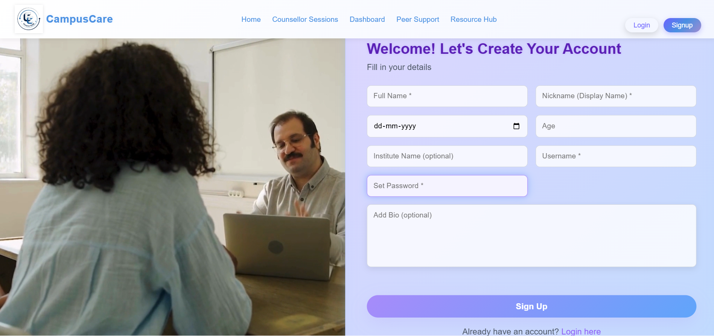

**Student Login**

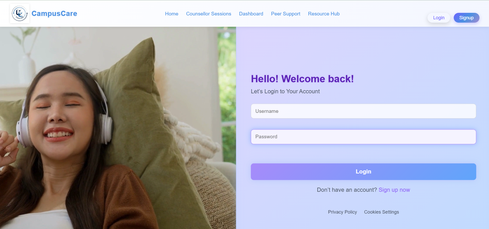

### 2. Student Home and Dashboard

**Student Home**

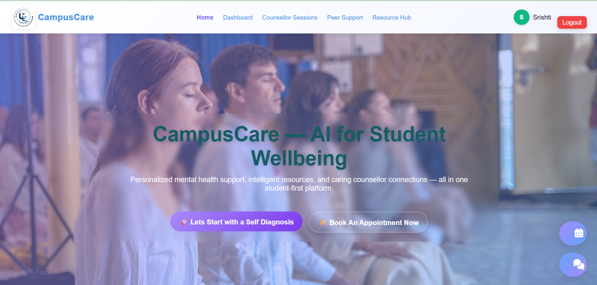

**Student Home – Additional View**

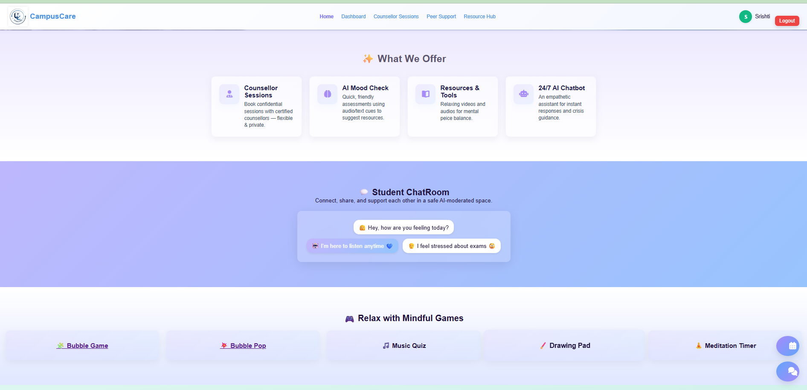

**Student Dashboard**

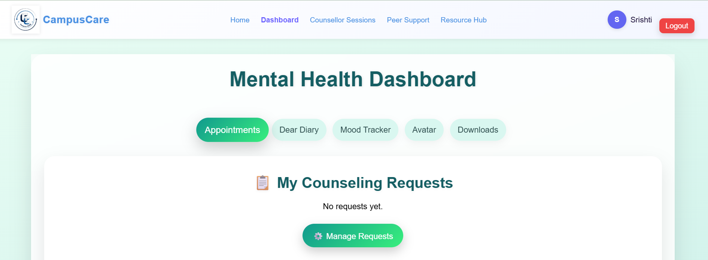

### 3. Student Wellness Features

**Mood Tracker**

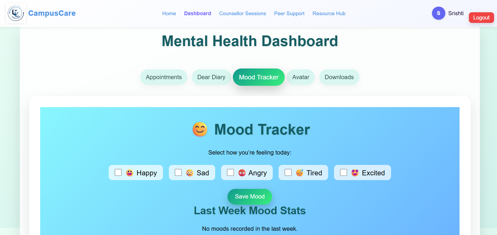

**Dear Diary**

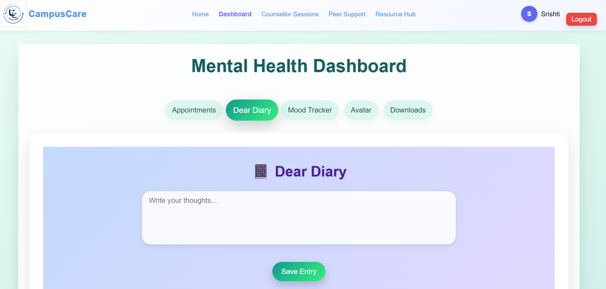

**Diagnosis**

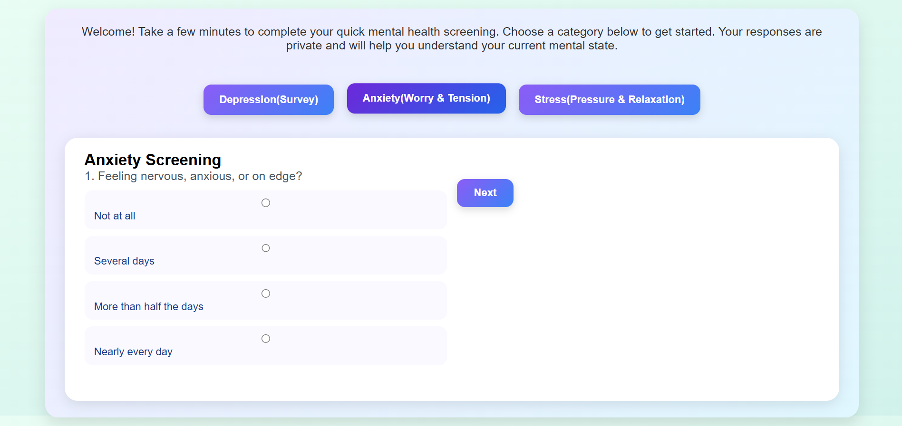

**Tips and Tricks**

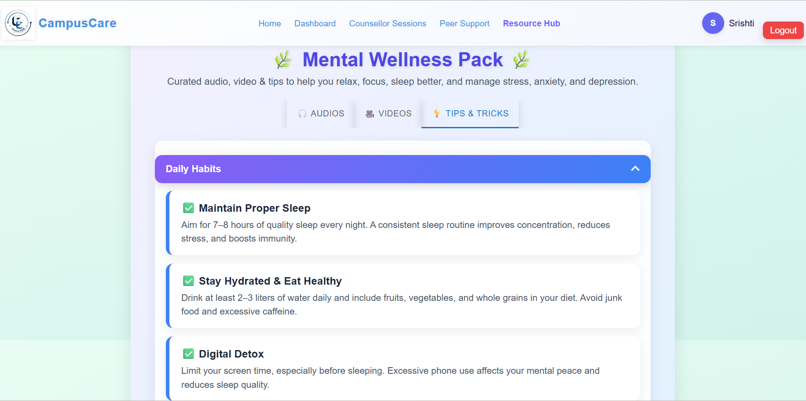

### 4. Appointment Booking and Management

**Appointment Booking**

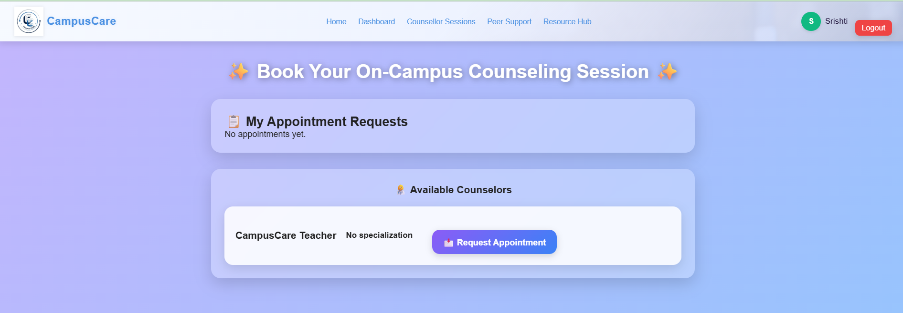

**Student Appointment Request**

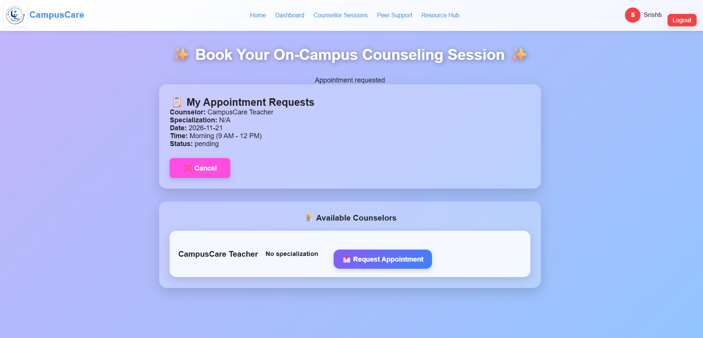

**Teacher Appointment Requests**

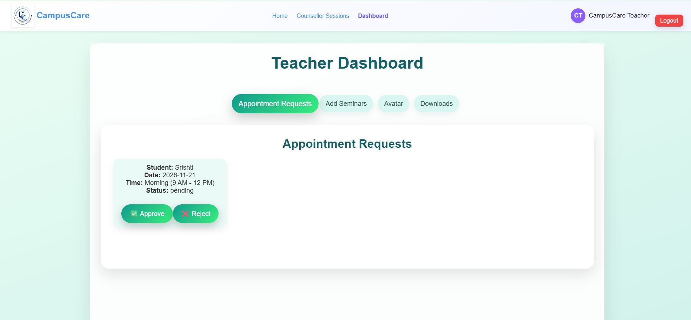

**Teacher Approves Appointment Request**

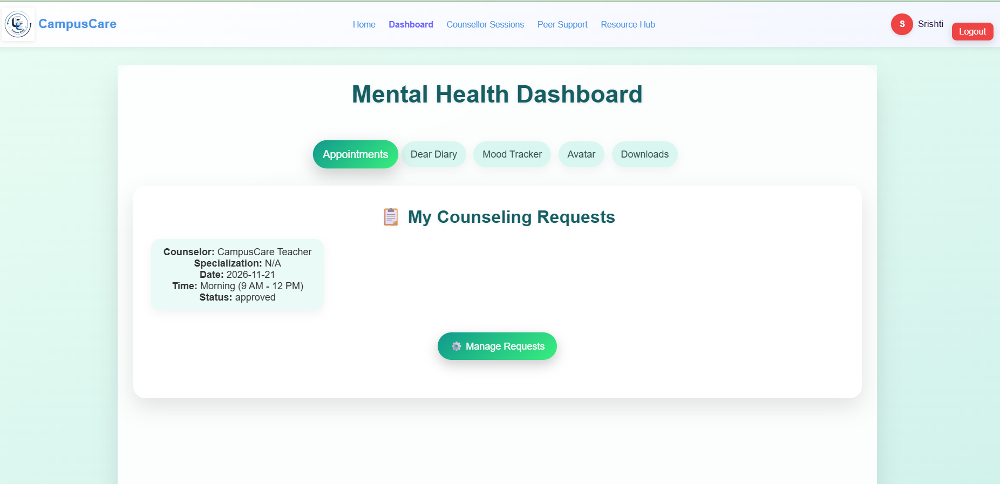

### 5. Communication and Learning

**Chat**

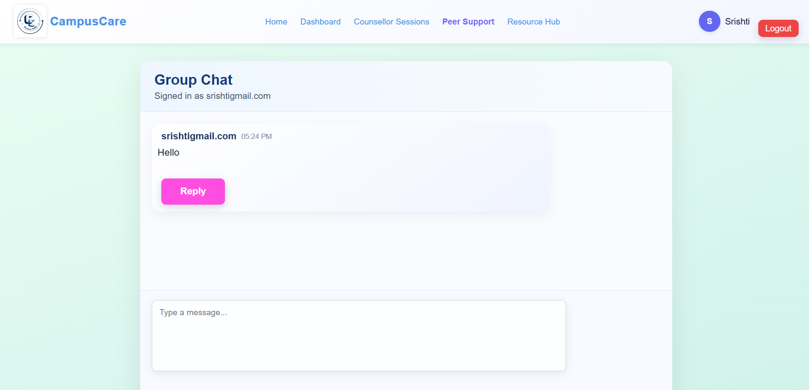

**Seminar**

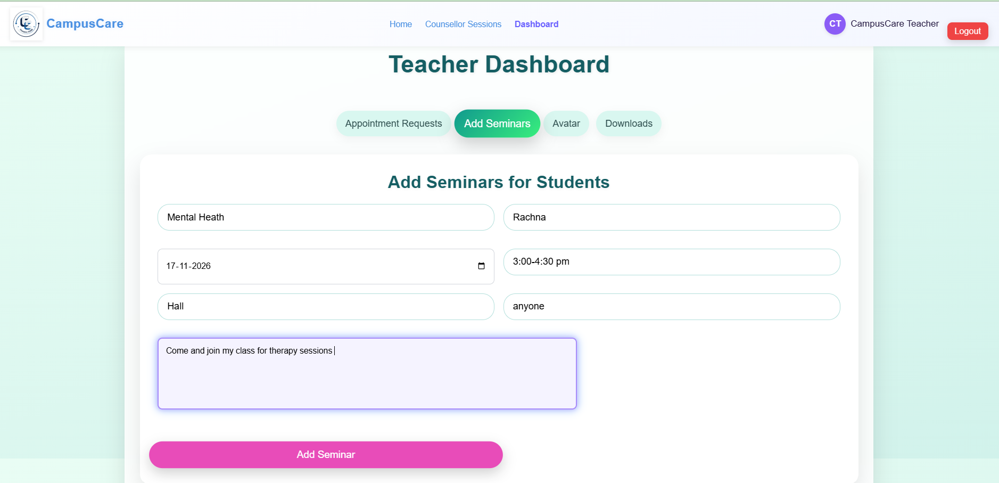

### 6. Audio and Video Features

**Audio**

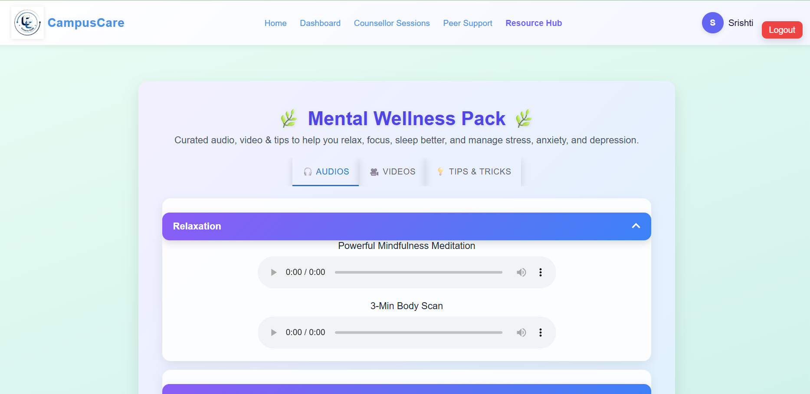

**Video**

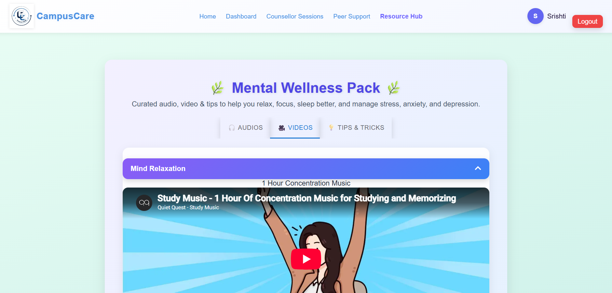

### 7. Stress Relief Games

**Bubble Game**

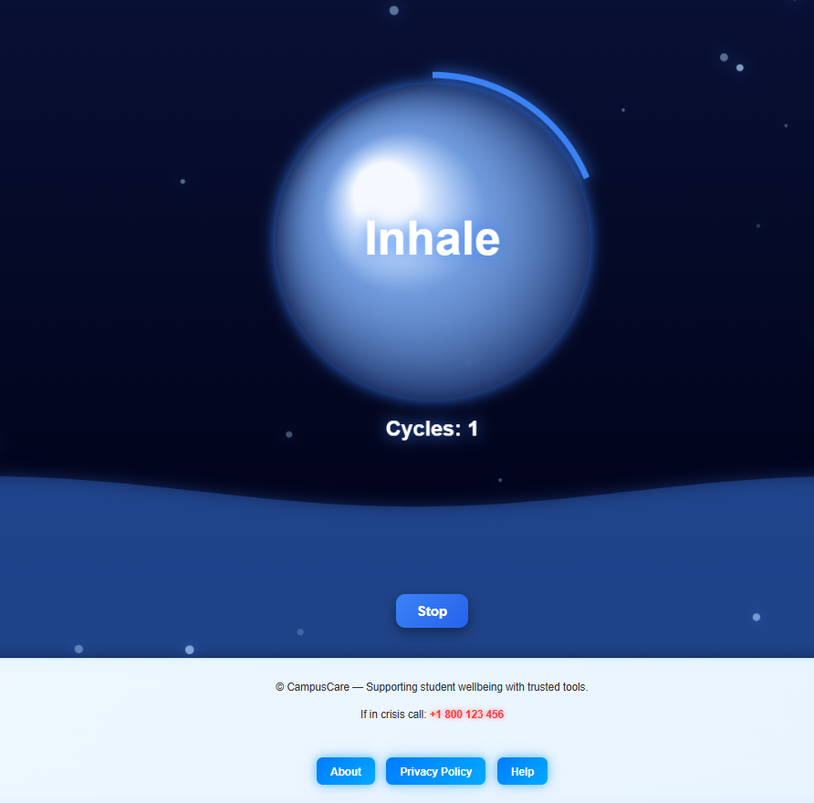

**Bubble Pop Game**

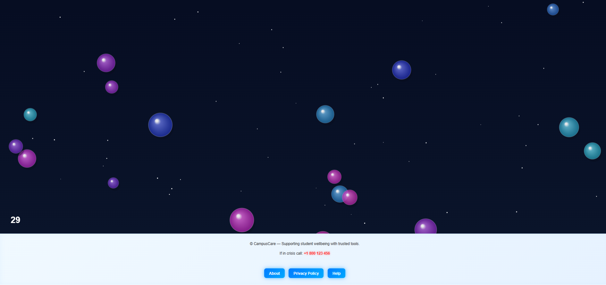

### 8. Teacher Interface

**Teacher Home**


**Teacher Home – Additional View**

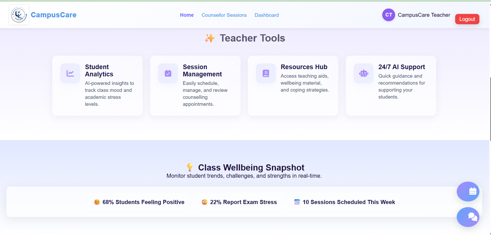

## Installation and Setup

### 1. Clone the Repository

```bash
git clone https://github.com/12srishti34/CampusCare.git
```

### 2. Navigate to the Project Folder

```bash
cd CampusCare
```

### 3. Install Backend Dependencies

```bash
cd backend
npm install
```

### 4. Configure Environment Variables

Create a `.env` file inside the backend folder and configure the required environment variables.

```env
PORT=5000
MONGO_URI=your_mongodb_connection_string
JWT_SECRET=your_secret_key
```

Use the environment variable names required by the backend configuration. Do not upload your actual `.env` file or secret keys to GitHub.

### 5. Start the Backend

```bash
npm start
```

### 6. Install Frontend Dependencies

Open another terminal and navigate to the client folder:

```bash
cd CampusCare/client
npm install
```

### 7. Start the Frontend

```bash
npm start
```

<<<<<<< HEAD
##  Project Objective

CampusCare aims to create a supportive digital environment where students can focus on their mental wellness, express themselves, connect with mentors, and access helpful activities.

##  Developed By

**Srishti Chadha**
=======
The frontend will generally run at `http://localhost:3000`, and the backend runs on the configured port.

## Project Objective

CampusCare aims to create a supportive digital environment where students can focus on their mental wellness, express themselves, connect with mentors, and access helpful activities.

## Developed By

**Srishti Chadha**

GitHub: [12srishti34](https://github.com/12srishti34)
>>>>>>> ad149db (Add Udated README with screenshots and links)
